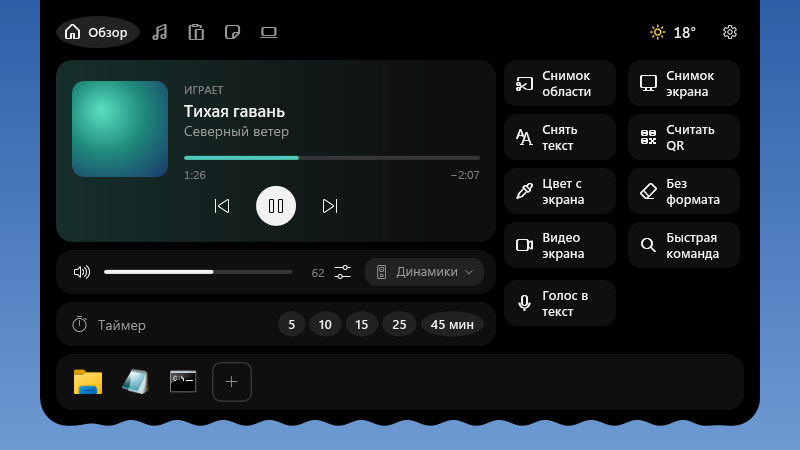
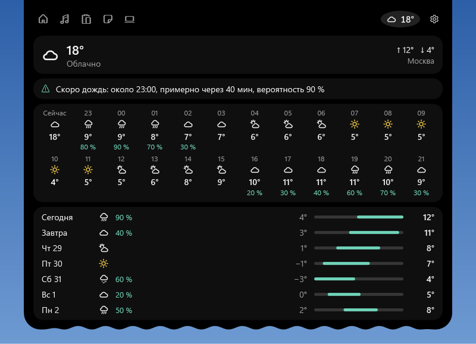
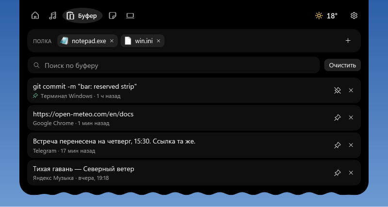
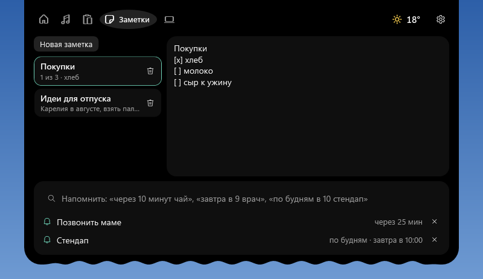
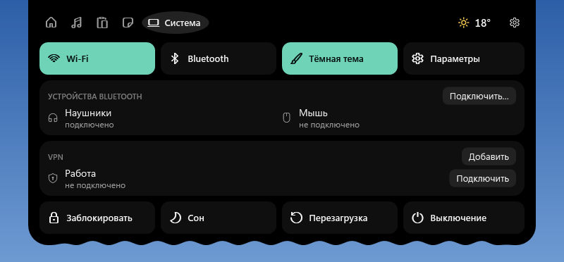
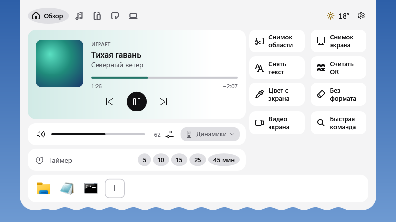

# Stillbar

**Полоска сверху, которая не мешает работать.** Stillbar — небольшая чёрная пилюля у верхнего края экрана Windows: время и погода, играющая музыка, таймер, загрузки, напоминания. Наведите курсор — она раскроется в панель с плеером, буфером обмена, заметками и быстрыми действиями. Фокус у окна, где вы печатаете, она не забирает.



## Установка

1. Скачайте **Stillbar-Setup-….exe** со страницы [Releases](../../releases/latest).
2. Запустите. Права администратора не нужны, .NET ставить не надо — всё внутри.
3. Windows может показать «Система Windows защитила ваш компьютер»: установщик не подписан сертификатом. Нажмите **Подробнее → Выполнить в любом случае**.

Нужна Windows 10 версии 2004 или новее либо Windows 11, 64-бит. Удаление — через «Параметры → Приложения»; при удалении Stillbar спросит, оставить ли ваши заметки и настройки.

## Что умеет

**Пилюля**
- время, погода; музыка из любого плеера с обложкой и эквалайзером; таймер; загрузки; запись экрана
- предупреждения: таймер закончился, напоминание, «скоро дождь» примерно за час
- раскладка (RU/EN) и Caps Lock — коротко, когда меняются
- статус **Claude Code**: над чем работает, и ответ на запрос разрешения прямо из пилюли

**Панель**
- **Обзор**: плеер с перемоткой, громкость, микшер по приложениям, выбор динамиков, таймер, ярлыки программ и 9 действий: снимок области с разметкой, снимок экрана, текст с экрана (OCR), QR-код, пипетка, «без формата», запись экрана, быстрая команда, голос в текст
- **Музыка**: мини-плеер с синхронным текстом песни (LRCLIB)
- **Буфер**: история копирования с поиском и закреплением, вставка в окно, где вы печатаете; полка для файлов
- **Заметки** со списками дел и **напоминания** фразой: «через 10 минут чай», «по будням в 10 стендап»
- **Система**: Wi-Fi, Bluetooth и устройства, тема Windows, VPN, блокировка, сон, перезагрузка, выключение
- **Погода**: 24 часа и неделя

**Alt+Пробел** — быстрая команда: приложения и файлы, калькулятор, единицы («5 км в милях»), «таймер 7 мин», «напомни…», «заметка…», транслит, раскладка, JSON, Base64.

**Не мешает**: своя полоса экрана (развёрнутые окна начинаются под пилюлей), сам перезапускается при зависании, верх или низ экрана, любой монитор, перетаскивание вбок, автоскрытие, сквозные клики, прячется в полноэкранных приложениях и рядом с выбранными программами. В простое — меньше 0,5 % процессора.

| | | |
|:-:|:-:|:-:|
|  |  |  |
|  |  |  |

## Что уходит в интернет

- название города → [Open-Meteo](https://open-meteo.com) (погода)
- исполнитель и название трека → [LRCLIB](https://lrclib.net), если включены слова песен
- один раз, при первой диктовке, если голосовой ввод Windows недоступен: модель распознавания речи [Vosk](https://alphacephei.com/vosk/) (~45 МБ)

Больше ничего: ни аккаунта, ни аналитики. Буфер обмена, заметки и голос остаются на компьютере. Содержимое, которое программы помечают как приватное (менеджеры паролей), в историю буфера не попадает.

## Claude Code

Настройки → «Claude Code» → **Подключить** добавляет хуки в `~/.claude/settings.json` (копия прежнего файла сохраняется рядом). Пилюля показывает проект, текущее действие и время, а запрос разрешения можно принять или отклонить кнопками в пилюле. Если Stillbar не запущен или не ответил за 24 секунды, Claude Code спрашивает как обычно — хук никогда не блокирует работу.

## Сборка

Нужен .NET 10 SDK.

```
dotnet test Stillbar.slnx
dotnet build Stillbar.slnx
```

Установщик (нужен [Inno Setup 6](https://jrsoftware.org/isinfo.php)): `powershell -File installer\build-installer.ps1` → `dist\Stillbar-Setup-<версия>.exe`.

Структура: `src/Stillbar.Core` — логика без интерфейса (разбор фраз, прогноз, буфер, хуки…), `src/Stillbar.App` — WPF-приложение, `tests/` — тесты xUnit.

## Сторонние компоненты

[CommunityToolkit.Mvvm](https://github.com/CommunityToolkit/dotnet) (MIT), [NAudio](https://github.com/naudio/NAudio) (MIT), [ZXing.Net](https://github.com/micjahn/ZXing.Net) (Apache 2.0), [Vosk](https://github.com/alphacep/vosk-api) и модель vosk-model-small-ru (Apache 2.0). Данные: Open-Meteo (CC BY 4.0), LRCLIB. Запись экрана использует [ffmpeg](https://ffmpeg.org), если он установлен у вас; в установщик он не входит.

## Лицензия

[MIT](LICENSE): можно свободно использовать, менять и распространять, сохраняя уведомление об авторских правах. Без гарантий.
